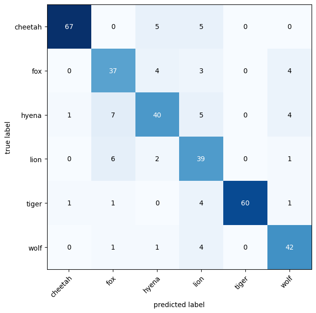
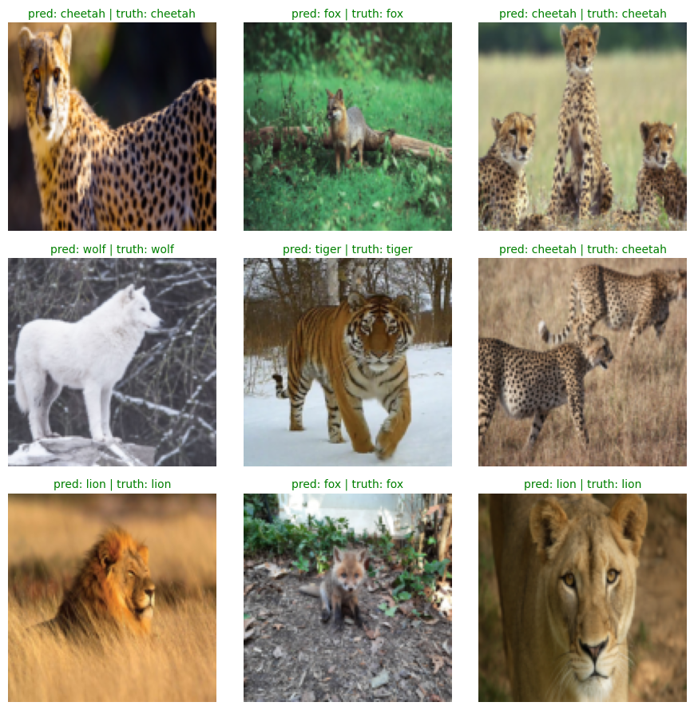

# Wildlife Image Classification Model

A deep convolutional neural network (CNN) built with PyTorch to classify wildlife animals into 6 distinct categories: **Cheetah**, **Fox**, **Hyena**, **Lion**, **Tiger**, and **Wolf**.


---

## Performance Summary

The model was evaluated on a held-out test split of 345 wildlife images, achieving strong classification accuracy and high precision across animal classes.

| Metric | Score |
| :--- | :--- |
| **Test Accuracy** | **82.61%** |
| **Weighted Precision** | **83.98%** |
| **Weighted Recall** | **82.61%** |
| **Weighted F1-Score** | **82.99%** |
| **Macro F1-Score** | **81.65%** |

### Per-Class Classification Report

| Class | Precision | Recall | F1-Score | Support |
| :--- | :---: | :---: | :---: | :---: |
| **Cheetah** | 97.10% | 87.01% | 91.78% | 77 |
| **Fox** | 71.15% | 77.08% | 74.00% | 48 |
| **Hyena** | 76.92% | 70.18% | 73.39% | 57 |
| **Lion** | 65.00% | 81.25% | 72.22% | 48 |
| **Tiger** | 100.00% | 89.55% | 94.49% | 67 |
| **Wolf** | 80.77% | 87.50% | 84.00% | 48 |
| **Macro Average** | 81.82% | 82.10% | 81.65% | 345 |
| **Weighted Average** | **83.98%** | **82.61%** | **82.99%** | **345** |

---

## Visualizations

### Confusion Matrix
The multiclass confusion matrix shows clean class separation, with particularly strong discrimination for Tigers (100% precision) and Cheetahs (97.1% precision).



### Sample Predictions
Batch predictions showing sample test inputs, predicted labels, and ground truth labels (green indicates correct classification):



---

## Model Architecture

The custom CNN (`AnimalModel`) consists of three convolutional blocks followed by an adaptive pooling classifier head:

```
AnimalModel(
  (conv_block_1): Sequential(
    Conv2d(3, 128, kernel_size=3, padding=1) -> ReLU() -> MaxPool2d(2)
    Conv2d(128, 128, kernel_size=3, padding=1) -> ReLU() -> MaxPool2d(2)
  )
  (conv_block_2): Sequential(
    Conv2d(128, 128, kernel_size=3, padding=1) -> ReLU() -> MaxPool2d(2)
    Conv2d(128, 128, kernel_size=3, padding=1) -> ReLU() -> MaxPool2d(2)
  )
  (conv_block_3): Sequential(
    Conv2d(128, 128, kernel_size=3, padding=1) -> ReLU() -> MaxPool2d(2)
    Conv2d(128, 128, kernel_size=3, padding=1) -> ReLU() -> MaxPool2d(2)
  )
  (classifier): Sequential(
    AdaptiveAvgPool2d(output_size=(4, 4))
    Flatten()
    Linear(in_features=2048, out_features=6)
  )
)
```

---

## Training Configuration & Data Pipeline

- **Dataset**: Wildlife Animals Images (`anshulmehtakaggl/wildlife-animals-images`)
- **Total Images**: 1,723 verified RGB images across 6 classes
- **Split**: 80% Train (1,378 images) / 20% Test (345 images), stratified with fixed seed `42`
- **Data Augmentations**:
  - `RandomResizedCrop(size=(128, 128), scale=(0.7, 1.0))`
  - `RandomHorizontalFlip(p=0.5)`
  - `RandomRotation(degrees=15)`
  - `ColorJitter(brightness=0.2, contrast=0.2, saturation=0.2)`
  - `Normalize(mean=[0.485, 0.456, 0.406], std=[0.229, 0.224, 0.225])`
  - `RandomErasing(p=0.3, scale=(0.02, 0.15))`
- **Hyperparameters**:
  - **Optimizer**: Adam (`lr=0.001`)
  - **Loss Function**: `CrossEntropyLoss(label_smoothing=0.1)`
  - **Batch Size**: 32
  - **Epochs**: 100

---

## Repository Structure

```
wildlife_image_model/
├── assets/
│   ├── confusion_matrix.png           # Multiclass confusion matrix
│   ├── prediction_plot.png            # 3x3 visual prediction grid
│   └── sample_transformed_image.png   # Sample augmented training image
├── wildlife_image_model.ipynb         # End-to-end training & evaluation notebook
├── requirements.txt                   # Dependencies
├── .gitignore
└── README.md                          # Project documentation
```

---

## Getting Started

### 1. Clone the repository
```bash
git clone https://github.com/demnzy/wildlife-image-model.git
cd wildlife-image-model
```

### 2. Install dependencies
```bash
pip install -r requirements.txt
```

### 3. Run the notebook
Launch Jupyter Notebook or Jupyter Lab to run `wildlife_image_model.ipynb`:
```bash
jupyter notebook wildlife_image_model.ipynb
```
